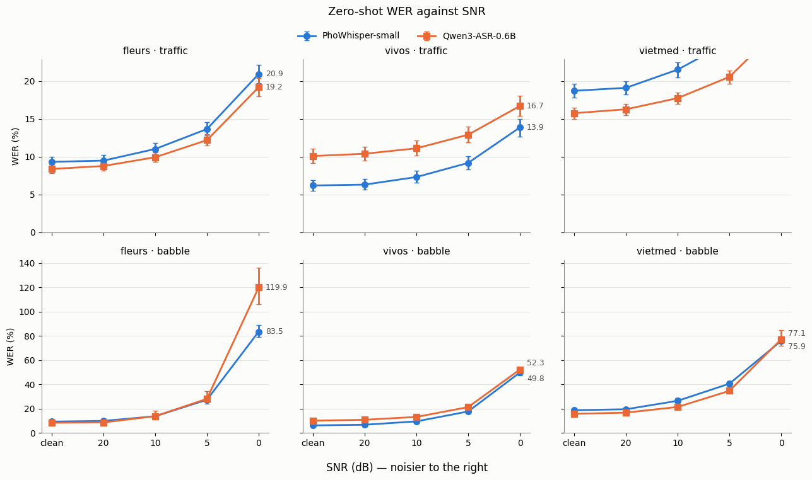
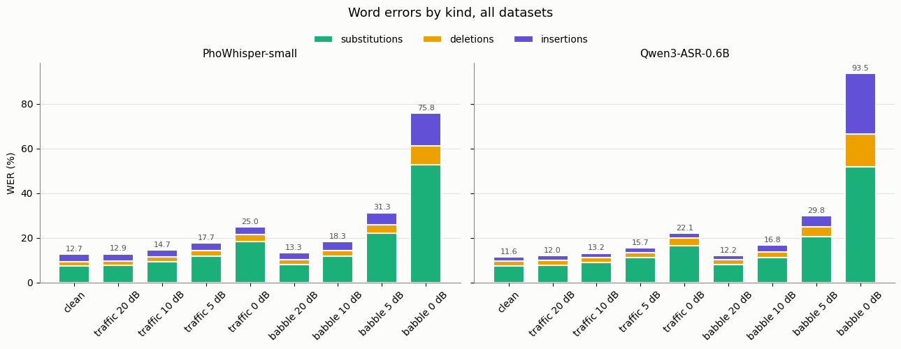
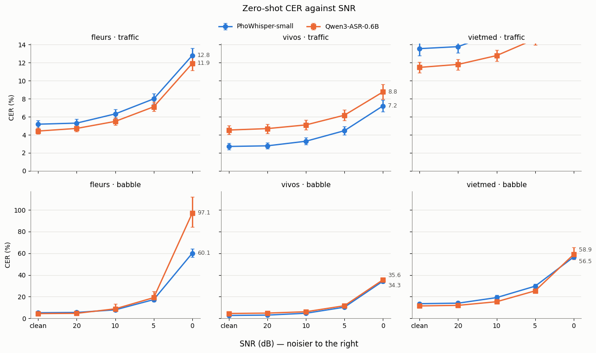

# Kết quả zero-shot

Kết quả của notebook `02_zero_shot`: PhoWhisper-small và Qwen3-ASR-0.6B, chưa fine-tune,
chạy trên toàn bộ test plan. Tài liệu này gồm số liệu, phân tích và kết luận dùng cho báo
cáo. Những chỗ ghi **Giả thuyết** là cách giải thích chưa được kiểm chứng; cần kiểm tra
trước khi viết thành kết luận.

| Mục | Giá trị |
|---|---|
| Code | commit `15f9667` (`feature/dataprep-evaluation`) |
| Dataset | `asr-noisy-vi` v1, seed 42 (`DATASET.json` được dựng lại trong notebook) |
| Phần cứng | Kaggle, Tesla T4, float16 |
| Decode | Greedy, ép ngôn ngữ tiếng Việt; `max_new_tokens` 440 (PhoWhisper), 512 (Qwen3-ASR) |
| Test plan | 2.610 câu × 9 điều kiện = 23.490 file mỗi model |
| Nguồn số liệu | Output của notebook `02_zero_shot` chạy trên Kaggle (`summary_zero-shot.csv`, `compare_wer.csv`, các hình) |

## Mục lục

1. [Tóm tắt](#1-tóm-tắt)
2. [Thiết lập và cách đọc số](#2-thiết-lập-và-cách-đọc-số)
3. [Tổng quan, gộp ba tập](#3-tổng-quan-gộp-ba-tập)
4. [Theo cường độ nhiễu](#4-theo-cường-độ-nhiễu)
5. [Theo loại nhiễu](#5-theo-loại-nhiễu)
6. [Theo tập dữ liệu](#6-theo-tập-dữ-liệu)
7. [So sánh hai model](#7-so-sánh-hai-model)
8. [Hallucination ở babble 0 dB](#8-hallucination-ở-babble-0-db)
9. [Hạn chế và bước tiếp theo](#9-hạn-chế-và-bước-tiếp-theo)
10. [Phụ lục: bảng số đầy đủ](#10-phụ-lục-bảng-số-đầy-đủ)

## 1. Tóm tắt

- **20 dB gần như vô hại**: WER tăng tối đa 0,7 điểm, với cả hai loại nhiễu và cả hai
  model.
- **Ở cùng SNR, babble khó hơn traffic hơn 5 dB**: babble 10 dB ≈ traffic 5 dB, và
  babble 5 dB còn tệ hơn traffic 0 dB.
- **Babble 0 dB làm cả hai model sụp**: WER gấp 6 lần (PhoWhisper) đến 8 lần (Qwen3-ASR)
  bản sạch, trong khi traffic 0 dB chỉ khoảng 2 lần.
- **Lỗi tăng phi tuyến** khi SNR giảm. Với babble, điểm gãy nằm giữa 10 và 5 dB.
- **Theo tập dữ liệu**: VIVOS dễ nhất và bền nhất; VietMed khó nhất khi sạch và khi có
  traffic; FLEURS bị babble 0 dB làm hỏng nặng nhất.
- **Theo cơ chế**: traffic chủ yếu làm tăng lỗi thay thế; babble làm tăng lỗi chèn, vì
  model chép luôn giọng nói nền.
- **Hai model**: Qwen3-ASR tốt hơn trên FLEURS và VietMed, và chịu traffic tốt hơn.
  PhoWhisper tốt hơn trên VIVOS khoảng 4 điểm gần như cố định, và tốt hơn ở babble 0 dB vì
  ít bịa hơn. Qwen3-ASR lên tới 119,9% WER trên FLEURS ở babble 0 dB.

## 2. Thiết lập và cách đọc số

Mỗi câu test được chấm ở 9 điều kiện: bản sạch, và SNR 20, 10, 5, 0 dB cho mỗi loại nhiễu.
Một câu dùng **cùng một đoạn nhiễu ở cả bốn mức SNR**, nên khác biệt giữa các mức chỉ đến
từ SNR. Hai model dùng chung test plan. Transcript tham chiếu và output của model được chuẩn
hoá giống nhau bằng `normalize_text` trước khi chấm, nên dấu câu và chữ hoa không bị tính
là lỗi.

### Ba tập test

| Tập | Số câu | Nội dung | Cần lưu ý |
|---|---:|---|---|
| FLEURS `vi_vn` | 850 | Đọc câu Wikipedia, 16 kHz | Tên riêng, từ mượn, khoảng 23% câu có chữ số; câu dài |
| VIVOS | 760 | Đọc trong phòng yên tĩnh, 16 kHz | Câu ngắn, từ vựng thông dụng, thu âm sạch |
| VietMed | 1.000 | Hội thoại y khoa, điện thoại, **8 kHz** | Lấy mẫu con có phân tầng theo điều kiện thu âm; nhiễu được giới hạn băng tần còn 4 kHz cho cùng kênh với tiếng nói |

### Nhiễu

- **Traffic**: clip từ FSD50K (xe cộ, đường phố).
- **Babble**: 3–5 giọng từ MUSAN `speech/librivox`, cộng lại bằng `make_babble`. Phần lớn
  là giọng tiếng Anh.

### WER

`WER = (S + D + I) / N × 100`, với N là số từ trong transcript tham chiếu, S là số từ bị
nhận sai thành từ khác (thay thế), D là số từ bị bỏ sót (xoá), I là số từ thừa do model
thêm vào (chèn). CER tính tương tự trên ký tự.

WER ở đây là **WER toàn corpus**: cộng lỗi của mọi câu rồi chia cho tổng số từ tham chiếu,
không lấy trung bình WER của từng câu. Câu dài có trọng số lớn hơn, và một câu bịa rất dài
có thể kéo cả điều kiện lên. Lỗi chèn không bị giới hạn nên **WER có thể vượt 100%**.

### SNR

SNR được tính trên toàn bộ câu, gồm cả các khoảng im lặng. Ở cùng SNR, traffic và babble có
cùng năng lượng, nên so hai loại nhiễu ở cùng một mức SNR là so sánh công bằng.

| SNR | Công suất nhiễu / tiếng nói | Biên độ nhiễu / tiếng nói |
|---|---:|---:|
| 20 dB | 1/100 | 1/10 |
| 10 dB | 1/10 | ≈ 0,32 |
| 5 dB | ≈ 1/3 | ≈ 0,56 |
| 0 dB | 1 | 1 |

## 3. Tổng quan, gộp ba tập

WER (%), tính trên toàn corpus của cả ba tập. **Δ sạch** là số điểm WER tăng so với bản
sạch; **× sạch** là tỉ số so với bản sạch.

| Điều kiện | PhoWhisper | Qwen3-ASR | Δ sạch Pho | Δ sạch Qwen | × sạch Pho | × sạch Qwen |
|---|---:|---:|---:|---:|---:|---:|
| clean | 12,67 | 11,58 | – | – | 1,00 | 1,00 |
| traffic 20 dB | 12,92 | 12,01 | +0,25 | +0,43 | 1,02 | 1,04 |
| traffic 10 dB | 14,73 | 13,24 | +2,06 | +1,66 | 1,16 | 1,14 |
| traffic 5 dB | 17,69 | 15,65 | +5,02 | +4,07 | 1,40 | 1,35 |
| traffic 0 dB | 25,05 | 22,09 | +12,38 | +10,51 | 1,98 | 1,91 |
| babble 20 dB | 13,33 | 12,18 | +0,66 | +0,60 | 1,05 | 1,05 |
| babble 10 dB | 18,27 | 16,78 | +5,60 | +5,20 | 1,44 | 1,45 |
| babble 5 dB | 31,33 | 29,81 | +18,66 | +18,23 | 2,47 | 2,57 |
| babble 0 dB | 75,82 | 93,48 | +63,15 | +81,90 | 5,98 | 8,07 |

*WER theo SNR, kèm khoảng tin cậy bootstrap 95% (hình từ notebook). Lỗi đã biết: trục y
dùng chung theo hàng, nên panel VietMed–traffic bị cắt ở khoảng 23%; giá trị đầy đủ nằm ở
[phụ lục](#10-phụ-lục-bảng-số-đầy-đủ).*

## 4. Theo cường độ nhiễu

- **20 dB**: tăng +0,25 đến +0,66 điểm. Model đã gặp nhiều audio có nhiễu nền nhẹ khi huấn
  luyện, nên mức này nằm trong vùng chúng quen.
- **10 dB**: bắt đầu thấy rõ, chủ yếu với babble (+5,6 và +5,2), trong khi traffic chỉ
  +1,7 đến +2,1.
- **5 dB**: điểm gãy của babble (+18,7 và +18,2). Traffic ở mức +4 đến +5.
- **0 dB**: traffic vẫn dùng được (WER 22–25%, khoảng 1 từ sai trên 4–5 từ); babble thì
  không (76–93%).

**Vì sao lỗi tăng phi tuyến.** SNR là thang log: từ 10 xuống 5 dB, công suất nhiễu tăng
khoảng 3,2 lần, và từ 5 xuống 0 dB lại tăng thêm 3,2 lần. Khi tiếng nói còn trội hơn nhiễu
trong các dải tần mang formant và phụ âm (khoảng 300–4.000 Hz), encoder vẫn giữ được đặc
trưng âm vị và mô hình ngôn ngữ của decoder sửa được phần còn lại. Khi nhiễu lấn át ở nhiều
dải cùng lúc, đặc trưng bị mất và lỗi tăng vọt. Vì vậy đường WER phẳng ở SNR cao và dốc ở
SNR thấp.

## 5. Theo loại nhiễu

| Cùng mức khó | PhoWhisper | Qwen3-ASR |
|---|---:|---:|
| babble 10 dB / traffic 5 dB | 18,27 / 17,69 | 16,78 / 15,65 |
| babble 5 dB / traffic 0 dB | 31,33 / 25,05 | 29,81 / 22,09 |

Ở cùng SNR, babble **khó hơn traffic hơn 5 dB**.

**Vì sao babble khó.**

- Babble là tiếng người: nằm cùng dải tần với tiếng nói chính (formant, khoảng
  300–3.400 Hz) và có cùng nhịp điều biến khoảng 4 Hz (nhịp âm tiết). Cách nào giữ được
  tiếng nói chính thì cũng giữ luôn babble.
- Babble gây **che thông tin** (*informational masking*), không chỉ che năng lượng: nó mang
  nội dung ngôn ngữ cạnh tranh. Model được huấn luyện để chép mọi tiếng nói nên không biết
  giọng nào là giọng cần chép.
- 3–5 giọng là ít. Từng giọng vẫn nghe rõ và có thể bị chép theo. Babble rất đông người thì
  gần với nhiễu ổn định hơn.

**Vì sao traffic dễ hơn.**

- Năng lượng dồn ở tần số thấp (động cơ, tiếng ầm) và khá ổn định theo thời gian. Ở cùng
  SNR tổng, dải 1–4 kHz chứa phụ âm bị che ít hơn.
- Nó không giống tiếng người nên model không biến nó thành chữ: lỗi chèn gần như không đổi.
- Dữ liệu huấn luyện quy mô web (Whisper, Qwen) có rất nhiều nhiễu nền loại này.

Phân rã lỗi theo loại (% số từ tham chiếu), gộp ba tập. S: thay thế, D: xoá, I: chèn.

| Điều kiện | S Pho | S Qwen | D Pho | D Qwen | I Pho | I Qwen |
|---|---:|---:|---:|---:|---:|---:|
| clean | 7,49 | 7,53 | 1,96 | 1,98 | 3,21 | 2,08 |
| traffic 20 dB | 7,74 | 7,91 | 2,03 | 1,99 | 3,15 | 2,11 |
| traffic 10 dB | 9,33 | 9,05 | 2,15 | 2,11 | 3,24 | 2,08 |
| traffic 5 dB | 12,00 | 11,15 | 2,42 | 2,41 | 3,26 | 2,10 |
| traffic 0 dB | 18,39 | 16,44 | 3,24 | 3,46 | 3,41 | 2,19 |
| babble 20 dB | 8,08 | 8,10 | 2,06 | 2,05 | 3,18 | 2,03 |
| babble 10 dB | 11,99 | 11,33 | 2,46 | 2,47 | 3,81 | 2,98 |
| babble 5 dB | 22,15 | 20,73 | 3,81 | 4,25 | 5,37 | 4,83 |
| babble 0 dB | 52,85 | 51,83 | 8,16 | 14,50 | 14,81 | 27,16 |

- **Traffic làm tăng lỗi thay thế** (PhoWhisper 7,5 → 18,4). Lỗi xoá tăng nhẹ
  (2,0 → 3,2), lỗi chèn gần như không đổi. Model vẫn nghe ra là có tiếng nói, nhưng nghe sai
  âm. Điều này trái với ghi chú trong notebook ("traffic raises deletions").
- **Babble 0 dB làm tăng cả ba loại lỗi**, nhiều nhất là lỗi chèn: 14,8 (PhoWhisper) và
  27,2 (Qwen3-ASR).

## 6. Theo tập dữ liệu

Tỉ số giữa WER ở 0 dB và WER sạch:

| Tập | WER sạch Pho / Qwen | traffic 0 dB Pho / Qwen | babble 0 dB Pho / Qwen |
|---|---:|---:|---:|
| FLEURS | 9,33 / 8,39 | ×2,2 / ×2,3 | ×8,9 / ×14,3 |
| VIVOS | 6,20 / 10,10 | ×2,2 / ×1,7 | ×8,0 / ×5,2 |
| VietMed | 18,73 / 15,77 | ×1,8 / ×1,7 | ×4,1 / ×4,9 |

Thứ tự độ khó giữ nguyên với traffic (VietMed > FLEURS > VIVOS), nhưng đổi ở babble 0 dB:
FLEURS trở thành tập tệ nhất.

### VIVOS: dễ nhất và bền nhất

WER sạch 6,2 (PhoWhisper) và 10,1 (Qwen3-ASR); khoảng 50% ở babble 0 dB, thấp nhất trong ba
tập.

- Phòng yên tĩnh, phát âm rõ, từ vựng thông dụng.
- Câu ngắn nên decoder ít có cơ hội "trôi" sang nội dung khác khi audio không rõ.
- **Giả thuyết**: PhoWhisper được fine-tune trên dữ liệu có VIVOS. Nếu đúng thì đây là lợi
  thế in-domain, khớp với việc PhoWhisper tốt hơn Qwen3-ASR khoảng 4 điểm ở mọi điều kiện.
  Cần đối chiếu danh sách dữ liệu huấn luyện trong paper PhoWhisper.
- Qwen3-ASR yếu với câu ngắn: "trở nên thụ động" bị nhận thành "giả nhiên đầu độc". Decoder
  kiểu LLM thiếu ngữ cảnh để đoán, và Qwen3-ASR được huấn luyện với ít tiếng Việt hơn
  PhoWhisper.

### FLEURS: trung bình khi sạch, tệ nhất ở babble 0 dB

WER sạch 9,3 và 8,4; ở babble 0 dB là 83,5 và 119,9 (gấp 9 và 14 lần bản sạch).

- Câu Wikipedia có tên riêng, từ mượn và số. Ngay trên audio sạch, "springboks" bị nhận
  thành "spurs" (PhoWhisper) và "Spring Boot" (Qwen3-ASR).
- Khoảng 23% câu có chữ số; khác biệt khi chuẩn hoá số ("2015" so với "hai nghìn không trăm
  mười lăm") có thể bị tính là lỗi nhận dạng.
- **Giả thuyết**: câu dài hơn nên khi decoder lạc hướng thì sinh ra nhiều chữ hơn.
- **Giả thuyết**: bản ghi FLEURS thường có khoảng im lặng ở đầu và cuối. SNR tính trên toàn
  câu, nên trong các đoạn đó chỉ còn babble, và model chép babble thành chữ. Cách kiểm tra:
  tính tỉ lệ im lặng của từng câu và xem tương quan với số lỗi chèn.

### VietMed: khó nhất khi sạch, suy giảm tương đối ít nhất

WER sạch 18,7 và 15,8; ở babble 0 dB là 75,9 và 77,1 (chỉ gấp 4–5 lần bản sạch).

- Khác cả về **kênh** lẫn **miền**. Băng hẹp 8 kHz làm mất các tần số cao giúp phân biệt
  phụ âm như s/x, ch/tr. Lời nói tự nhiên, có ngập ngừng và thuật ngữ y khoa ("thuyên tắc
  huyết khối" bị nhận thành "thuyên tắc với khối").
- Suy giảm tương đối nhỏ một phần vì WER sạch đã cao.
- **Giả thuyết**: tiếng nói không có gì trên 4 kHz, nên model vốn không dựa vào dải đó cho
  tập này, và nhiễu đã giới hạn băng tần không lấy đi thêm thông tin nào ở đó.

## 7. So sánh hai model

Paired bootstrap trên WER, Qwen3-ASR trừ PhoWhisper, 1.000 lần lấy mẫu lại, khoảng tin cậy
95%. Âm nghĩa là Qwen3-ASR tốt hơn. **Có ý nghĩa** nghĩa là khoảng tin cậy không chứa 0.

| Tập | Điều kiện | Pho | Qwen | Δ | KTC 95% | Có ý nghĩa |
|---|---|---:|---:|---:|---|:-:|
| FLEURS | clean | 9,33 | 8,39 | −0,94 | [−1,48; −0,44] | có |
| FLEURS | traffic 20 dB | 9,49 | 8,78 | −0,71 | [−1,27; −0,20] | có |
| FLEURS | traffic 10 dB | 11,03 | 9,94 | −1,09 | [−1,69; −0,55] | có |
| FLEURS | traffic 5 dB | 13,67 | 12,20 | −1,47 | [−2,07; −0,87] | có |
| FLEURS | traffic 0 dB | 20,94 | 19,20 | −1,75 | [−2,53; −1,00] | có |
| FLEURS | babble 20 dB | 9,91 | 8,65 | −1,26 | [−1,84; −0,75] | có |
| FLEURS | babble 10 dB | 13,73 | 13,81 | +0,08 | [−2,22; 4,37] | không |
| FLEURS | babble 5 dB | 27,32 | 28,10 | +0,78 | [−2,80; 5,91] | không |
| FLEURS | babble 0 dB | 83,47 | 119,86 | +36,39 | [22,89; 51,67] | có |
| VIVOS | clean | 6,20 | 10,10 | +3,90 | [3,19; 4,62] | có |
| VIVOS | traffic 20 dB | 6,32 | 10,40 | +4,08 | [3,31; 4,80] | có |
| VIVOS | traffic 10 dB | 7,32 | 11,12 | +3,81 | [3,05; 4,51] | có |
| VIVOS | traffic 5 dB | 9,19 | 12,92 | +3,73 | [2,88; 4,65] | có |
| VIVOS | traffic 0 dB | 13,88 | 16,72 | +2,84 | [1,82; 3,70] | có |
| VIVOS | babble 20 dB | 6,76 | 10,85 | +4,09 | [3,36; 4,80] | có |
| VIVOS | babble 10 dB | 9,52 | 13,20 | +3,68 | [2,77; 4,55] | có |
| VIVOS | babble 5 dB | 17,70 | 21,29 | +3,59 | [2,33; 4,81] | có |
| VIVOS | babble 0 dB | 49,82 | 52,27 | +2,45 | [0,26; 4,63] | có |
| VietMed | clean | 18,73 | 15,77 | −2,96 | [−3,72; −2,20] | có |
| VietMed | traffic 20 dB | 19,12 | 16,28 | −2,83 | [−3,52; −2,20] | có |
| VietMed | traffic 10 dB | 21,53 | 17,76 | −3,77 | [−4,49; −3,06] | có |
| VietMed | traffic 5 dB | 25,22 | 20,57 | −4,64 | [−5,41; −3,97] | có |
| VietMed | traffic 0 dB | 33,58 | 27,26 | −6,33 | [−7,17; −5,53] | có |
| VietMed | babble 20 dB | 19,52 | 16,70 | −2,82 | [−3,46; −2,16] | có |
| VietMed | babble 10 dB | 26,48 | 21,42 | −5,06 | [−7,10; −3,57] | có |
| VietMed | babble 5 dB | 40,60 | 34,68 | −5,92 | [−8,04; −4,34] | có |
| VietMed | babble 0 dB | 75,86 | 77,12 | +1,25 | [−4,01; 8,83] | không |

- **Qwen3-ASR tốt hơn trên FLEURS và VietMed** khi sạch, ở mọi mức traffic và ở babble
  ≥ 10 dB (VietMed: đến cả babble 5 dB). Chênh lệch lớn nhất ở VietMed (−3 đến −6 điểm):
  decoder LLM có mô hình ngôn ngữ mạnh hơn, giúp với thuật ngữ và lời nói tự nhiên.
- **Qwen3-ASR chịu traffic tốt hơn**: ở traffic 0 dB tăng +10,5 điểm so với bản sạch, so với
  +12,4 của PhoWhisper (gộp ba tập).
- **PhoWhisper tốt hơn trên VIVOS ở cả 9 điều kiện**, chênh 2,5–4,1 điểm. Khoảng chênh gần
  như không đổi theo SNR, nên đây là khác biệt ở mức nền (dữ liệu in-domain), không phải
  khác biệt về độ bền với nhiễu.
- **Hai model đổi chỗ khi babble to dần.** Trên FLEURS, lợi thế của Qwen3-ASR mất từ babble
  10 dB và đảo ngược ở 0 dB (+36,4 điểm). Trên VietMed, hai model hoà nhau ở babble 0 dB.

## 8. Hallucination ở babble 0 dB

Ở babble 0 dB, hai model nghe sai số từ gần như ngang nhau (S ≈ 52). WER của Qwen3-ASR cao
hơn vì nó **chèn nhiều từ bịa hơn** (27,2 so với 14,8) và **bỏ sót nhiều từ hơn** (14,5 so
với 8,2).

Năm câu sai nặng nhất đều của Qwen3-ASR ở babble 0 dB, mỗi câu khoảng **510 lỗi**. Con số
này khớp với `max_new_tokens=512`: model sinh văn bản cho đến khi bị cắt. PhoWhisper (giới
hạn 440) cũng bị lặp, nhưng ít hơn.

| Model | Câu | Lỗi | Tham chiếu (đầu câu) | Output (đầu câu) |
|---|---|---:|---|---|
| Qwen3-ASR | `fleurs_315968779387989758` | 511 | máy tính asus eee được ra mắt trên toàn thế gi… | chúng ta sẽ đi đến một nơi mà chúng ta sẽ có t… |
| Qwen3-ASR | `vietmed_utt_id_test_002522` | 510 | ở những người người phụ nữ ở việt nam thì nhân… | cũng không có lý do gì mà chúng ta không có lý… |
| PhoWhisper | `fleurs_11158540918299428613` | 434 | do đó hai loài cá đã tuyệt chủng và hai loài k… | ra thiên tòa số số số số số số số số số số số… |

- **Qwen3-ASR bịa văn bản trôi chảy**: tiếng Việt đúng ngữ pháp nhưng không có trong audio.
  Đây là mặt trái của mô hình ngôn ngữ mạnh: khi bằng chứng âm thanh yếu, prior của LLM lấn
  át và nó tiếp tục sinh văn bản "hợp lý".
- **PhoWhisper bị kẹt vòng lặp** ("số số số…"), lỗi quen thuộc của Whisper khi decoder mất
  bám vào audio.
- Output đều là tiếng Việt dù babble chủ yếu là tiếng Anh, vì ngôn ngữ bị ép khi decode.
- Vài câu như vậy đủ đẩy WER toàn corpus lên trên 100% (FLEURS: 119,9%). Con số này không
  có nghĩa là mọi từ đều sai.

## 9. Hạn chế và bước tiếp theo

### Hạn chế

- **WER toàn corpus nhạy với hallucination.** Nên báo cáo thêm WER trung vị theo câu, hoặc
  **tỉ lệ hallucination** (ví dụ số câu có output dài hơn 2 lần tham chiếu), để tách "nghe
  sai" với "bịa".
- **Chữ số trong FLEURS.** Nên tách kết quả theo `has_digit` để biết bao nhiêu lỗi đến từ
  cách viết số.
- **Babble chủ yếu là tiếng Anh.** Model có thể tách giọng nền khác ngôn ngữ dễ hơn babble
  tiếng Việt, nên kết quả có thể lạc quan hơn tình huống thực tế ở Việt Nam. Cần ghi rõ
  trong báo cáo.
- **Clip traffic có đoạn im lặng.** Một số clip FSD50K im lặng một phần; khi đoạn nhiễu im
  lặng một phần, phần còn lại của câu bị nhiễu hơn mức SNR dự kiến.
- **VietMed khác cả kênh lẫn miền**, nên không tách được ảnh hưởng của nhiễu với ảnh hưởng
  của audio 8 kHz và lời nói tự nhiên.

### Trước khi so sánh với fine-tune

- Nếu giới hạn `max_new_tokens` theo độ dài audio, hoặc chặn lặp n-gram, phải áp dụng cho
  **cả hai** model và ghi rõ trong phần phương pháp.
- Khoảng cải thiện lớn nhất cho LoRA fine-tune nằm ở **babble 5 và 0 dB**. Traffic và
  SNR ≥ 10 dB chỉ còn vài điểm để cải thiện. Nên đặt kỳ vọng và tiêu chí đánh giá theo hướng
  đó.
- So sánh model fine-tune với zero-shot bằng cùng paired bootstrap, và theo dõi riêng lỗi
  chèn ở babble 0 dB.
- Sửa ghi chú trong notebook `02_zero_shot` nói rằng traffic làm tăng lỗi xoá.
- Sửa trục y dùng chung trong `wer_vs_snr.png` và `cer_vs_snr.png` để panel VietMed–traffic
  không bị cắt.

### Gợi ý bố cục phần kết quả trong báo cáo

1. Bảng WER/CER theo tập × điều kiện ([phụ lục](#10-phụ-lục-bảng-số-đầy-đủ)).
2. WER theo SNR ([mục 3](#3-tổng-quan-gộp-ba-tập)), kèm nhận định: ở cùng SNR, babble khó
   hơn traffic hơn 5 dB.
3. Phân rã lỗi S/D/I ([mục 5](#5-theo-loại-nhiễu)) để giải thích cơ chế của từng loại nhiễu.
4. Bảng paired bootstrap ([mục 7](#7-so-sánh-hai-model)) để so sánh hai model.
5. Ví dụ hallucination ([mục 8](#8-hallucination-ở-babble-0-db)), kèm tỉ lệ hallucination
   khi đã tính được.

## 10. Phụ lục: bảng số đầy đủ

### WER (%)

| Tập | Điều kiện | PhoWhisper | Qwen3-ASR |
|---|---|---:|---:|
| FLEURS | clean | 9,33 | 8,39 |
| FLEURS | traffic 20 dB | 9,49 | 8,78 |
| FLEURS | traffic 10 dB | 11,03 | 9,94 |
| FLEURS | traffic 5 dB | 13,67 | 12,20 |
| FLEURS | traffic 0 dB | 20,94 | 19,20 |
| FLEURS | babble 20 dB | 9,91 | 8,65 |
| FLEURS | babble 10 dB | 13,73 | 13,81 |
| FLEURS | babble 5 dB | 27,32 | 28,10 |
| FLEURS | babble 0 dB | 83,47 | 119,86 |
| VIVOS | clean | 6,20 | 10,10 |
| VIVOS | traffic 20 dB | 6,32 | 10,40 |
| VIVOS | traffic 10 dB | 7,32 | 11,12 |
| VIVOS | traffic 5 dB | 9,19 | 12,92 |
| VIVOS | traffic 0 dB | 13,88 | 16,72 |
| VIVOS | babble 20 dB | 6,76 | 10,85 |
| VIVOS | babble 10 dB | 9,52 | 13,20 |
| VIVOS | babble 5 dB | 17,70 | 21,29 |
| VIVOS | babble 0 dB | 49,82 | 52,27 |
| VietMed | clean | 18,73 | 15,77 |
| VietMed | traffic 20 dB | 19,12 | 16,28 |
| VietMed | traffic 10 dB | 21,53 | 17,76 |
| VietMed | traffic 5 dB | 25,22 | 20,57 |
| VietMed | traffic 0 dB | 33,58 | 27,26 |
| VietMed | babble 20 dB | 19,52 | 16,70 |
| VietMed | babble 10 dB | 26,48 | 21,42 |
| VietMed | babble 5 dB | 40,60 | 34,68 |
| VietMed | babble 0 dB | 75,86 | 77,12 |

### CER (%)

| Tập | Điều kiện | PhoWhisper | Qwen3-ASR |
|---|---|---:|---:|
| FLEURS | clean | 5,18 | 4,42 |
| FLEURS | traffic 20 dB | 5,30 | 4,71 |
| FLEURS | traffic 10 dB | 6,32 | 5,49 |
| FLEURS | traffic 5 dB | 7,99 | 7,11 |
| FLEURS | traffic 0 dB | 12,81 | 11,92 |
| FLEURS | babble 20 dB | 5,47 | 4,65 |
| FLEURS | babble 10 dB | 7,88 | 8,81 |
| FLEURS | babble 5 dB | 17,32 | 19,14 |
| FLEURS | babble 0 dB | 60,07 | 97,07 |
| VIVOS | clean | 2,71 | 4,53 |
| VIVOS | traffic 20 dB | 2,78 | 4,69 |
| VIVOS | traffic 10 dB | 3,29 | 5,10 |
| VIVOS | traffic 5 dB | 4,46 | 6,18 |
| VIVOS | traffic 0 dB | 7,21 | 8,76 |
| VIVOS | babble 20 dB | 3,03 | 4,87 |
| VIVOS | babble 10 dB | 4,73 | 6,12 |
| VIVOS | babble 5 dB | 10,32 | 11,66 |
| VIVOS | babble 0 dB | 34,34 | 35,58 |
| VietMed | clean | 13,56 | 11,48 |
| VietMed | traffic 20 dB | 13,78 | 11,81 |
| VietMed | traffic 10 dB | 15,35 | 12,79 |
| VietMed | traffic 5 dB | 17,91 | 14,63 |
| VietMed | traffic 0 dB | 24,05 | 19,67 |
| VietMed | babble 20 dB | 14,02 | 12,01 |
| VietMed | babble 10 dB | 19,16 | 15,36 |
| VietMed | babble 5 dB | 29,69 | 25,39 |
| VietMed | babble 0 dB | 56,55 | 58,93 |

